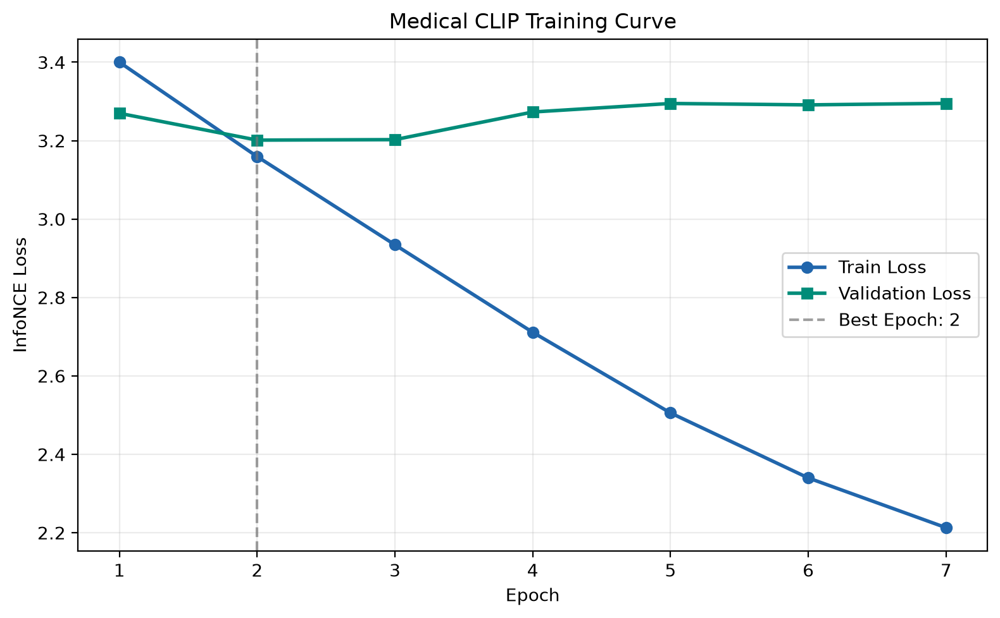
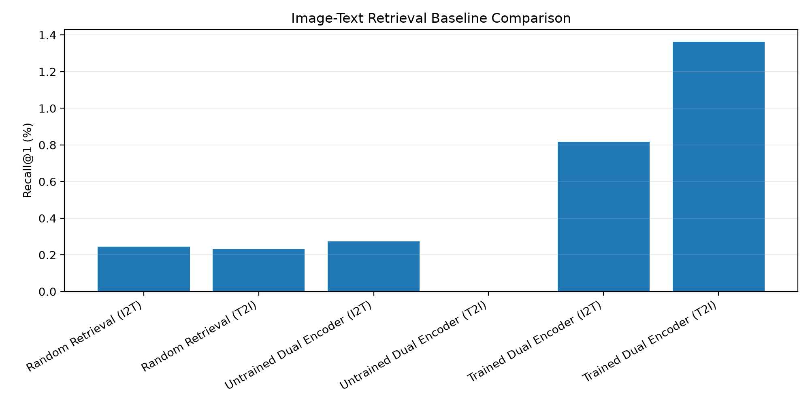
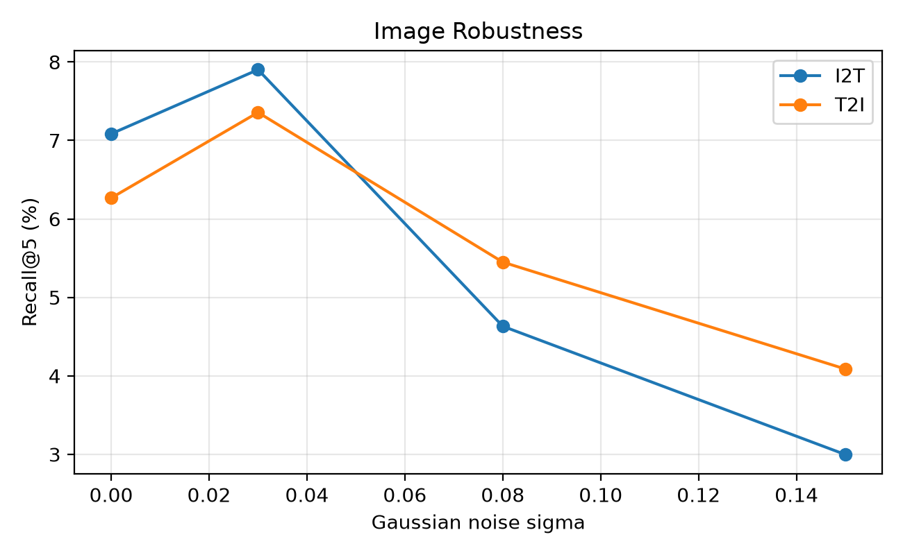
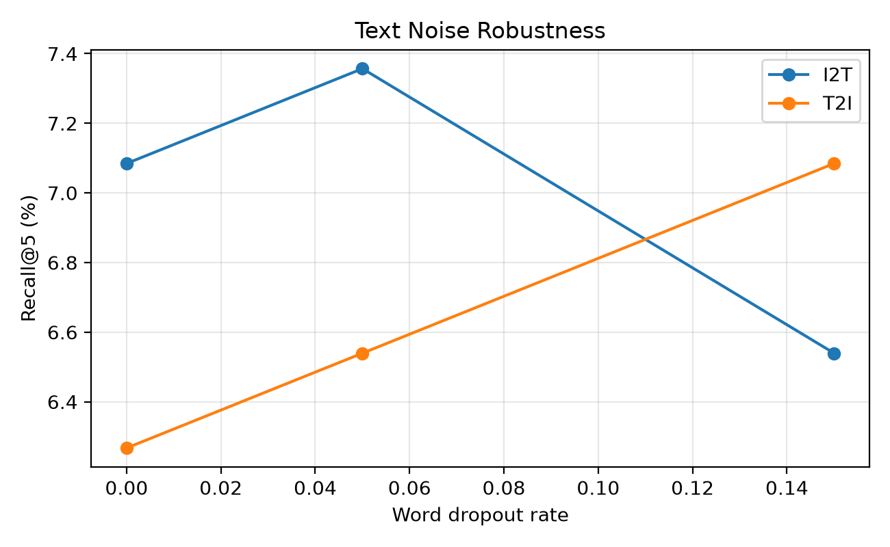
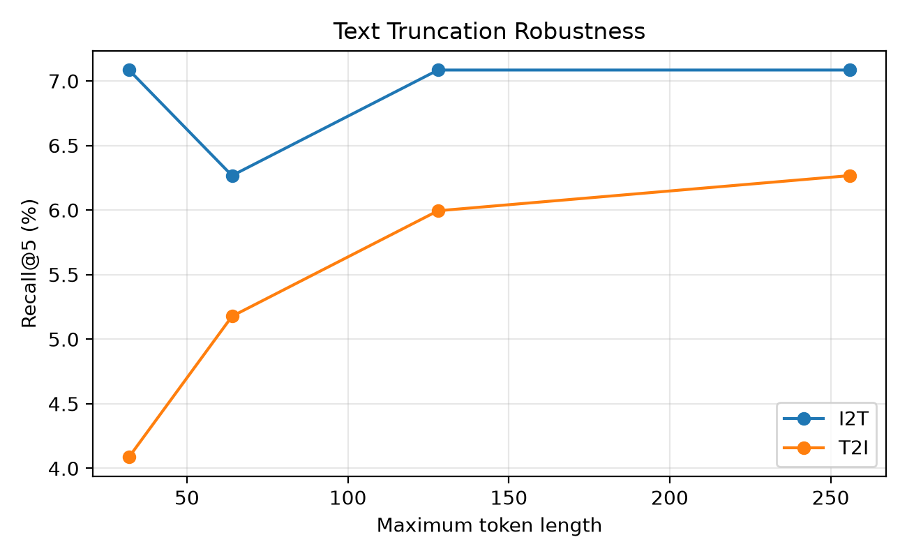

# Medical Image–Text Representation Learning: Technical Report

This report summarizes the existing local experimental artifacts exported with this repository. Preparing the repository did not rerun representation learning or evaluate an independent test set. All retrieval results below use the validation partition.

## 1. Task and scope

The main task is paired chest X-ray–report retrieval. Image-to-text retrieval (I2T) ranks candidate reports for each image; text-to-image retrieval (T2I) ranks candidate images for each report. A correct result is the designated image–report UID pair. The task does not measure disease classification accuracy, clinical usefulness, or prognostic validity.

The project implements a CLIP-style model using separately pretrained components. Its local `MedicalCLIP` class name does not identify a downloaded, jointly pretrained medical CLIP checkpoint.

## 2. Data and pairing protocol

The locally prepared IU X-Ray data contain 3,794 matched frontal image–report records and 3,666 unique report UIDs. Reports combine the `findings` and `impression` fields after handling missing values and normalizing whitespace. Images are restricted to frontal projections before pairing.

| Partition | Image–report records | Unique report UIDs |
|---|---:|---:|
| Training | 3,039 | 2,932 |
| Validation | 383 | 367 |
| Held-out test | 372 | 367 |

The partitioning code groups by report UID. Training and retrieval then retain the lexicographically first image filename for each UID, producing a simplified one-image/one-report protocol. Every reported validation retrieval run ranks against the same pool of 367 candidates in each direction.

Report UID separation does not establish patient separation: a verified patient identifier is unavailable in the supplied pairing metadata. The held-out test partition exists, but no test retrieval score is reported here. The exported [split UID lists](../splits/) record the existing partition assignments; raw images, report text, and feature arrays are not included in the publication assets.

## 3. Model and optimization

- The ImageNet-pretrained ResNet-18 image encoder has its classification layer replaced by an identity operation, producing 512-dimensional features.
- `emilyalsentzer/Bio_ClinicalBERT` produces 768-dimensional token features. Attention-mask-aware mean pooling produces one vector per report, excluding padding. Special tokens whose masks equal one remain in the mean.
- Two linear projection heads map image and report features to 256 dimensions. Both outputs are L2-normalized.
- The projection heads have 328,192 trainable parameters in total: `512 × 256 + 256` and `768 × 256 + 256`.
- Symmetric cross-entropy over image-to-text and text-to-image similarity matrices implements the single-positive contrastive objective, with temperature 0.07. The paired diagonal is the target; other batch entries act as negatives.

The frozen-encoder stage consumes cached features and updates only the projection heads. Its recorded settings are batch size 32, AdamW learning rate 0.0001, weight decay 0.01, at most 20 epochs, and early-stopping patience 5. The saved [training history](../results/training_history.csv) contains seven epochs. Validation loss is lowest at epoch 2 (3.201383); training loss continues to decrease while validation loss subsequently increases. The inspected projection checkpoint also records epoch 2.

The original validation-loss loader drops its incomplete last batch, evaluating 352 of 367 unique validation pairs for model selection. Full retrieval evaluation uses all 367 pairs. The loss-based selection score is therefore distinct from full-pool retrieval performance.

The partial fine-tuning stage loads the learned projection heads, reads raw images again, unfreezes ResNet-18 `layer4`, and keeps cached report features fixed. Its settings are batch size 8, three epochs, layer4 learning rate 0.00001, projection learning rate 0.0001, and weight decay 0.01. BatchNorm running statistics remain fixed through evaluation mode, while gradients still update layer4. Model selection maximizes the average of I2T and T2I validation R@5. The inspected local fine-tuning checkpoint records epoch 3.

The earlier pneumonia classifier is a separate supervised exercise. Its learned classification checkpoint is not used to initialize this retrieval pipeline.

## 4. Retrieval results

R@K is the percentage of queries for which the designated paired item ranks in the top K. MedR is the median one-based rank; lower is better. No confidence intervals or multi-training-seed averages are available. The random retrieval baseline alone averages 20 random score matrices.

| Method | Direction | R@1 (%) | R@5 (%) | R@10 (%) | MedR |
|---|---|---:|---:|---:|---:|
| Random retrieval | I2T | 0.245 | 1.294 | 2.766 | 184.10 |
| Random retrieval | T2I | 0.232 | 1.281 | 2.779 | 184.15 |
| Untrained projection heads | I2T | 0.272 | 1.907 | 3.815 | 188 |
| Untrained projection heads | T2I | 0.000 | 0.817 | 2.452 | 183 |
| Frozen encoders, trained heads | I2T | 0.817 | 4.905 | 6.812 | 89 |
| Frozen encoders, trained heads | T2I | 1.362 | 4.360 | 7.357 | 90 |
| Fine-tuned layer4 and heads | I2T | 1.362 | 7.084 | 12.807 | 89 |
| Fine-tuned layer4 and heads | T2I | 1.090 | 6.267 | 11.717 | 90 |

Sources: [retrieval comparison](../results/retrieval_comparison.csv) and [ablation results](../results/day7_ablation.csv). The CSV label `Untrained Dual Encoder` means pretrained encoders with randomly initialized cross-modal projection heads; the encoders themselves are not untrained.

Mean R@5 increases from 4.632% to 6.676%, a gain of 2.044 percentage points, or about 44.1% relative to the frozen-encoder baseline. This is a descriptive comparison on the model-selection validation set. Top-one retrieval remains close to 1%, so the relative improvement should not be mistaken for strong absolute performance.

The [day6 final comparison](../results/day6_final_comparison.csv) is an exported summary of these existing frozen and fine-tuned rows. It is not an additional experiment or independent measurement.

## 5. Robustness and post-training intervention

The [robustness CSV](../results/day7_robustness.csv) covers one deterministic realization per setting. Image Gaussian noise is added after ImageNet normalization, not directly in raw `[0, 1]` pixel space. Word dropout protects selected negation terms. Truncation lengths refer to tokenizer tokens, not words.

| Setting | I2T R@5 (%) | T2I R@5 (%) | Mean R@5 (%) |
|---|---:|---:|---:|
| Clean image baseline | 7.084 | 6.267 | 6.676 |
| Image noise sigma 0.03 | 7.902 | 7.357 | 7.629 |
| Image noise sigma 0.08 | 4.632 | 5.450 | 5.041 |
| Image noise sigma 0.15 | 2.997 | 4.087 | 3.542 |
| Word dropout 5% | 7.357 | 6.540 | 6.948 |
| Word dropout 15% | 6.540 | 7.084 | 6.812 |
| Text truncated to 32 tokens | 7.084 | 4.087 | 5.586 |

Strong image noise lowers retrieval performance. Small perturbations sometimes improve a metric in this one run, which is insufficient evidence of a stable benefit. Truncation to 32 tokens leaves I2T R@5 unchanged but worsens I2T MedR from 89 to 107 and T2I MedR from 90 to 110; a single recall cutoff does not describe the entire ranking distribution.

The clean image experiment uses cached report features, whereas text perturbation experiments recompute them. Their clean I2T R@10 values differ slightly (12.807% versus 13.351%). Text perturbations should be compared against their own re-encoded clean baseline.

Replacing adapted layer4 weights with their original ImageNet values, while retaining the trained heads, gives mean R@5 of 6.131%. This intervention shows dependence on the adapted representation but also creates a feature/head mismatch. It does not isolate a causal contribution of layer4 or replace a separately trained frozen-encoder control.

## 6. Data audit and duplicate-text effects

The [audit CSV](../results/day7_data_audit.csv) reports:

| Partition pair | UID overlap | Filename overlap | Exact image-file hash overlap | Distinct normalized report texts in common |
|---|---:|---:|---:|---:|
| Training / validation | 0 | 0 | 0 | 57 |
| Training / test | 0 | 0 | 0 | 54 |
| Validation / test | 0 | 0 | 0 | 26 |

Patient overlap is explicitly `UNVERIFIABLE`. File hashes detect byte-identical files, not re-encoded or approximately duplicated images. The reported text-overlap counts are counts of distinct normalized strings, not numbers of patients or queries. Repeated report templates alone neither prove leakage nor establish independence.

Among 367 validation UID queries, 91 (24.80%) have a normalized report text seen in training, and 276 do not. The validation set has 333 distinct normalized report texts; 51 UID records belong to internally duplicated text groups. All 51 belong to the seen group, so the seen/unseen comparison is confounded by duplicate-text structure.

| Query group | Queries per direction | I2T R@5 (%) | T2I R@5 (%) | Mean R@5 (%) |
|---|---:|---:|---:|---:|
| Seen report text | 91 | 2.198 | 2.198 | 2.198 |
| Unseen report text | 276 | 8.696 | 7.609 | 8.152 |

Source: [seen/unseen comparison](../results/day7_seen_unseen_comparison.csv). Only queries are filtered by group: every query still ranks against the full 367-candidate pool. Lower scores in the seen group are not proof that training-set text has no influence.

Strict UID matching treats equivalent or identical reports assigned to other UIDs as incorrect. Such reports can create false negatives during contrastive training and ambiguous ties during retrieval. A text mismatch is also not evidence that two reports differ in clinical meaning. Instance matching and clinically meaningful semantic retrieval require different evaluation protocols.

## 7. Reproducibility and provenance

The published CSVs and figures are historical artifacts from the local learning experiments. The unified `config.yaml` and shared reproducibility helper were added afterwards. Independent DataLoader generators and deterministic-algorithm settings change how randomness is consumed; rerunning the updated scripts is not guaranteed to reproduce every historical CSV value exactly.

The current helper seeds Python, NumPy, PyTorch CPU/CUDA RNGs and DataLoader generators. Independently constructed NumPy generators are seeded explicitly. Exact results can still vary across hardware and software versions. Current configuration files are not a substitute for unavailable historical per-run configuration snapshots.

Changing a configuration value does not invalidate or regenerate cached features or split CSVs automatically. Changing report encoding requires regenerating corresponding feature caches; changing the seed changes a split only when the splitting script is run again. Existing-checkpoint architecture values take precedence where recorded to keep loading compatible.

Published assets intentionally include only code, configuration, UID split lists, aggregate result tables, figures of aggregate results, and this report. Raw datasets, report text, model checkpoints, and cached features remain local. The failure-case CSV contains report text and is not part of the curated aggregate result set.

## 8. Separate survival tutorial

The survival tutorial generates 1,500 synthetic patients using age, severity, and independent scalar variables named `image_signal` and `text_signal`. These scalars are not embeddings from the retrieval model. The tutorial demonstrates right censoring, Kaplan–Meier estimation, penalized Cox regression, discrimination, fixed-horizon risk, and group calibration.

The previously checked default run has 610 observed events, 890 censored observations, 1,050 training patients, 450 test patients, a three-month KM event risk of approximately 0.1313, and test C-index approximately 0.6943. These are synthetic demonstration results, not clinical prognosis results, retrieval scores, or validation of the learned image–text representation. The figures and retrieval CSVs above do not depend on this tutorial.

## 9. Interpretation and next evaluation steps

The artifacts demonstrate a working pairing, feature-extraction, contrastive-training, and retrieval workflow. The main unresolved issues are limited absolute retrieval performance, model selection and comparison on the same validation set, unverified patient independence, duplicate reports, the single-positive target, and missing uncertainty estimates.

A stronger evaluation would define clinically meaningful positives, preserve a patient- and time-valid evaluation split when identifiers permit, evaluate on untouched test data, compare multiple training seeds, and quantify uncertainty. Investigating survival endpoints additionally requires actual patient-linked longitudinal outcomes and censoring information; the supplied retrieval dataset and synthetic tutorial do not provide that evidence.
